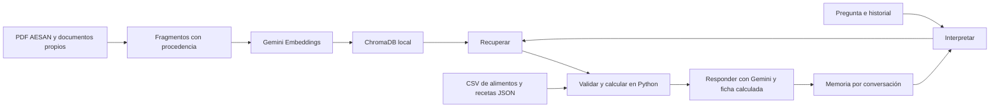

# MILO — Mi asistente de cocina con Gemini y RAG

He creado MILO como proyecto académico de IA generativa. Utilizo documentos para responder preguntas de nutrición general y recetas revisadas para calcular nutrientes. Gemini interpreta y explica; Python valida los ingredientes y realiza las operaciones. Mi entrega principal es [MILO_Proyecto_Final.ipynb](MILO_Proyecto_Final.ipynb).

## Qué puedo ejecutar

Tengo un RAG real con tres documentos, Gemini Embeddings y ChromaDB. Puedo ver los fragmentos recuperados y las fuentes junto a cada respuesta. También puedo conversar con un agente LangGraph que recuerda la receta anterior y utiliza la calculadora nutricional. He conservado el catálogo de 70 alimentos y las 12 recetas: siete están revisadas y cinco siguen pendientes de composición o alérgenos de productos compuestos.

Todavía no he construido la interfaz Streamlit, el planificador semanal, la lista de compra ni el modo nevera. Mantengo su estado en una sola [checklist](PROJECT_CHECKLIST.md).

## Instalación y configuración

Desde la raíz del proyecto, en PowerShell:

```powershell
py -m venv .venv
.\.venv\Scripts\python.exe -m pip install -r requirements.txt
```

Si ya existe `.venv`, utilizo ese entorno. He comprobado la ejecución local con Python 3.14.5. Declaro las dependencias en `pyproject.toml`; `requirements-lock.txt` recoge las versiones del entorno comprobado. Para reproducir esas versiones puedo instalarlas antes de `requirements.txt`.

Si todavía no tengo `.env`, copio `.env.example` a `.env` y escribo mi clave privada:

```dotenv
GOOGLE_API_KEY=mi_clave_privada
MILO_MODEL=gemini-3.5-flash-lite
MILO_EMBEDDING_MODEL=gemini-embedding-001
MILO_EMBEDDING_DIMENSION=3072
```

El código carga el `.env` de la **raíz** aunque ejecute desde otra carpeta. No utiliza `evaluation/.env`. Las variables del entorno tienen prioridad. No imprimo ni incluyo la clave en Git; `.env.example` contiene únicamente una plantilla vacía.

He comprobado llamadas reales al generador y a los embeddings. En esta cuenta, `gemini-2.5-flash` rechazó la generación por disponibilidad para nuevos usuarios y una prueba de `gemini-3.8-flash` agotó el tiempo de espera. He dejado como predeterminado `gemini-3.5-flash-lite`, que sí respondió. Puedo cambiar `MILO_MODEL` si mi cuenta dispone de otro modelo, pero debo volver a comprobar las respuestas y las pruebas reales.

## Documentos, índice y demostración

Los originales están en `data/raw`; los dos documentos propios están en `data/documents`. Si clono el repositorio sin los archivos grandes, ejecuto primero:

```powershell
.\.venv\Scripts\python.exe scripts/download_sources.py
```

Este script descarga los archivos registrados y verifica su hash y formato. Conserva los originales existentes. Registro los intentos de descarga en `data/sources.json`, junto a la procedencia, sin otro manifiesto duplicado.

Para regenerar el documento de recetas revisadas, registrar ambos documentos propios e indexar:

```powershell
.\.venv\Scripts\python.exe scripts/prepare_documents.py
.\.venv\Scripts\python.exe scripts/ingest.py --index
.\.venv\Scripts\python.exe scripts/demo.py
```

`demo.py` ejecuta cinco preguntas del RAG. Para una pregunta concreta o una conversación con herramientas:

```powershell
.\.venv\Scripts\python.exe scripts/demo.py "Recomiéndame una receta sencilla con pollo y arroz."
.\.venv\Scripts\python.exe scripts/demo.py --agent
```

Las llamadas reales requieren red y cuota de Gemini. Una primera ejecución del notebook alcanzó el límite de 15 peticiones por minuto de esta cuenta; he añadido un límite compartido de 12 llamadas por minuto dentro de cada proceso. Ejecuto las demostraciones y las pruebas reales de forma secuencial, porque ese límite no coordina varios procesos ni otras aplicaciones que usen la misma clave. Ante un 429 espero el plazo indicado y repito; otros límites de cuota pueden requerir revisar la cuenta. Los errores de API se propagan; no genero respuestas ficticias como alternativa.

Si modifico un documento, actualizo sus metadatos e indexo de nuevo. Los identificadores de colección incorporan la versión del contenido y del embedding. Repetir la indexación del mismo corpus añade únicamente los vectores que faltan. Chroma guarda sus datos en `storage/chroma`.

## Cómo funciona



El grafo ejecuta cuatro nodos una vez por turno: interpretar, recuperar, herramientas y responder. Gemini devuelve una intención estructurada; el código solo admite conocimiento general, recetas, cálculo, escalado o aclaración. La calculadora utiliza `Decimal`, gramos comestibles y el estado de cada ingrediente. La ficha de pesos y nutrientes se construye directamente con Python.

Mi prompt pide español claro, limita las afirmaciones a la evidencia recuperada y trata los documentos como datos, no como instrucciones. Exige citas y reserva los cálculos a Python. Compruebo que las citas existan, pero eso no demuestra que cada frase esté respaldada: la revisión de contenido y una evaluación más amplia siguen siendo necesarias.

Para memoria utilizo `InMemorySaver`: conservo historial, perfil y última receta, incluido un escalado, dentro del mismo objeto `MiloAgent`. Otro `thread_id` mantiene un estado separado. La memoria no sobrevive al reinicio de Python. Esta separación no implementa autenticación de usuarios.

Registro restricciones explícitas en un perfil; el modelo no puede modificarlas:

```python
from milo.agent import MiloAgent
from milo.models import DietaryRestriction, UserProfile

agente = MiloAgent()
perfil = UserProfile(user_id="demo", restrictions=[
    DietaryRestriction(kind="allergy", value="egg")
])
turno = agente.ask("Quiero la receta r002 de tortilla de espinacas.",
                   thread_id="demo", profile=perfil)
print(turno["answer"])  # La receta no supera la restricción registrada.
```

No considero que un mensaje libre haya registrado de forma fiable todas las alergias. La interpretación pide aclaración ante restricciones nuevas, pero la validación determinista utiliza exclusivamente `UserProfile`. No afirmo que una receta sea segura frente a trazas o contaminación cruzada.

## Organización simplificada

```text
MILO_Proyecto_Final.ipynb     Explicación y demostración ejecutable
README.md                   Instalación, decisiones y límites
PROJECT_CHECKLIST.md        Único seguimiento principal
src/milo/
  config.py                 Configuración privada
  models.py                 Contratos y validación de datos
  catalog.py, usda.py        Consulta e importación del catálogo
  nutrition.py              Cálculos, restricciones y escalado
  rag.py                    Ingestión, embeddings, Chroma y generación
  agent.py                  LangGraph y memoria
data/
  raw/                      Documentos y archivos oficiales originales
  documents/                Recetario y técnicas del RAG
  structured/               Dataset, selecciones y recetas; borradores originales
  sources.json              Procedencia e intentos de descarga
scripts/                    Preparación, demostración y verificación
tests/                      Pruebas conservadas y nuevas comprobaciones
storage/                    Índice y archivos locales; excluido de Git
```

He fusionado los módulos pequeños de nutrición y agrupado el RAG. Antes de retirar los archivos redundantes comprobé sus referencias y guardé una copia verificada en `storage/antes_simplificacion.zip`. La documentación histórica, los informes antiguos y los módulos sustituidos siguen accesibles en `storage/archivado`. Los borradores de datos y los originales oficiales permanecen en `data`. No he reconstruido el catálogo USDA durante esta simplificación.

## Datos y cálculos que puedo explicar

He utilizado el CSV Foundation de abril de 2026 como base. El CSV de octubre pasa la comprobación CRC, pero carece de `food.csv` y `food_nutrient.csv`; por eso lo mantengo como archivo incompleto. Cuatro registros se actualizaron completos desde el JSON de octubre, sin mezclar nutrientes entre versiones. Cinco complementos proceden de SR Legacy: aceite de oliva genérico, girasol linoleico, lentejas cocidas, tofu firme con calcio y quinoa seca. El aceite de oliva genérico no rellena las ausencias del registro Foundation de AOVE.

Conservo los IDs originales y compruebo descripciones, unidades y duplicados. Uno `food.fdc_id` con `food_nutrient.fdc_id` y resuelvo nutrientes mediante `food_nutrient.nutrient_id = nutrient.id`. No confundo `nutrient.id` con `nutrient_nbr` ni promedio muestras para crear alimentos.

| Campo | ID USDA | Interpretación |
|---|---|---|
| `protein_g` | 1003 | Proteína publicada en g/100 g |
| `carbs_g` | 1005 | Hidratos por diferencia, no hidratos netos |
| `fat_g` | 1004 | Grasa publicada en g/100 g |
| `fiber_g` | 1079 | Fibra; puede ser desconocida |
| `kcal` | 2048, 2047, 1008 | Prioridad: Atwater específico, general y energía publicada |

Calculo `sum(gramos / 100 × nutriente_por_100g)` y después divido por raciones. Mantengo `null` si falta algún aporte; cero significa un cero publicado. No infiero energía mediante 4/4/9, convierto estados crudo/cocinado ni invento rendimiento de cocción. Redondeo solo para mostrar. Un escalado admite factores de 0,5 a 2 y queda pendiente de revisión culinaria; no optimiza macros ni calcula necesidades personales.

Las recetas revisadas son r001, r002, r003, r006, r008, r010 y r012. Las cinco pendientes son r004 (pasta y conservas), r005 (garbanzos en conserva), r007 (pan), r009 (tortilla de trigo) y r011 (tofu). En los borradores concreté explícitamente variedades y estados: tomate roma, yogur entero, arroz seco, salmón de cultivo y pavo picado cocinado. La mezcla de frutos rojos se concretó en fresa y frambuesa. Los pasos y tiempos son adaptaciones del proyecto, no ensayos físicos de cocina ni recetas oficiales USDA.

## Notebook y pruebas

Abro `MILO_Proyecto_Final.ipynb` con el intérprete de `.venv`, o lo ejecuto completo así:

```powershell
.\.venv\Scripts\python.exe scripts/run_notebook.py
```

He ejecutado las diez celdas de código del notebook en orden, sin errores. Guarda salidas reales en sus diez secciones: introducción, configuración, documentos, chunking, embeddings, Chroma, LangGraph, memoria, cinco consultas y conclusiones. Las cinco consultas del agente recuperaron la fuente esperada. Las pruebas automáticas permanecen fuera del notebook para facilitar la presentación.

```powershell
# Comprobaciones locales; no llama a Gemini.
.\.venv\Scripts\python.exe scripts/verify.py
# Incluye recuperación/generación real, memoria y ejecución del notebook.
.\.venv\Scripts\python.exe scripts/verify.py --live
```

He superado 88 pruebas: 82 locales y seis con API real. También han pasado Ruff y `pip check`. Las pruebas locales comprueban cálculo, estados, datos originales, restricciones y controles del grafo. Los dobles de prueba están identificados y no cuentan como evidencia de API. `--live` activa seis casos reales adicionales. Las cinco consultas de recuperación comprueban fuentes esperadas y citas existentes, no una exactitud universal del sistema.

## Referencias

- [AESAN: recomendaciones dietéticas saludables y sostenibles](https://www.aesan.gob.es/AECOSAN/docs/documentos/nutricion/RECOMENDACIONES_DIETETICAS.pdf).
- [USDA FoodData Central: documentación](https://fdc.nal.usda.gov/data-documentation.html).
- [Google: embeddings de Gemini](https://ai.google.dev/gemini-api/docs/embeddings).
- [LangGraph: memoria conversacional](https://docs.langchain.com/oss/python/langgraph/add-memory).
- [FoodSafety.gov: temperaturas mínimas](https://www.foodsafety.gov/food-safety-charts/safe-minimum-internal-temperatures).

Los documentos propios incluyen sus referencias adicionales. MILO ofrece educación nutricional general; no diagnostica ni prescribe tratamientos.
