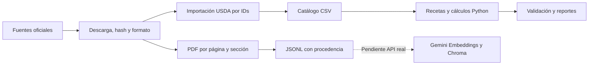

# Arquitectura aprobada e implementación

El usuario aprobó la propuesta al solicitar Sprint 1 el 30/10/2026 (Europe/Madrid). MILO es un monolito modular Python: notebook y futuro Streamlit compartirán servicios; RAG recuperará evidencia; Gemini interpretará/explicará; Python validará/calculará.

Implementado: configuración, contratos, repositorios USDA/catálogo, nutrición y restricciones, ingestión PDF, scripts, notebook offline y pruebas. `agent/` y `memory/` documentan alcance futuro. No hay chat simulado.

Grafo futuro: `prepare_turn → interpret_request → retrieve_context → plan_action → execute_tools → validate_result → compose_response → finalize_turn`, con rutas de aclaración/límites y ciclos acotados. Los documentos son datos, nunca instrucciones. Los números visibles procederán de resultados Python.

Memoria futura: checkpointer por hilo para conversación/artefactos y perfil estructurado de preferencias explícitas. `thread_id` vendrá de la aplicación; sesiones aisladas. No se infieren alergias ni objetivos diarios. Resolver persistencia externa antes de prometer memoria duradera en Streamlit Cloud.

Corpus futuro: al menos tres documentos sustanciales o unas veinte páginas pertinentes, Gemini Embeddings, Chroma, recuperación evaluada y citas. AESAN aporta 19 páginas; el diccionario USDA no es guía nutricional. Los borradores no cuentan como conocimiento validado.

Pendientes: LangGraph, memoria, clasificador, recomendador, plan semanal, compra, nevera y Streamlit. Orden: cerrar datos/corpus → embeddings/recuperación → Gemini/grafo → memoria/evaluación → notebook académico → planificación/compra → interfaz/despliegue. La checklist define criterios de cierre para cada fase.
